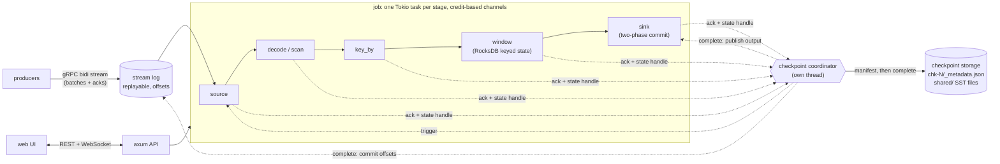
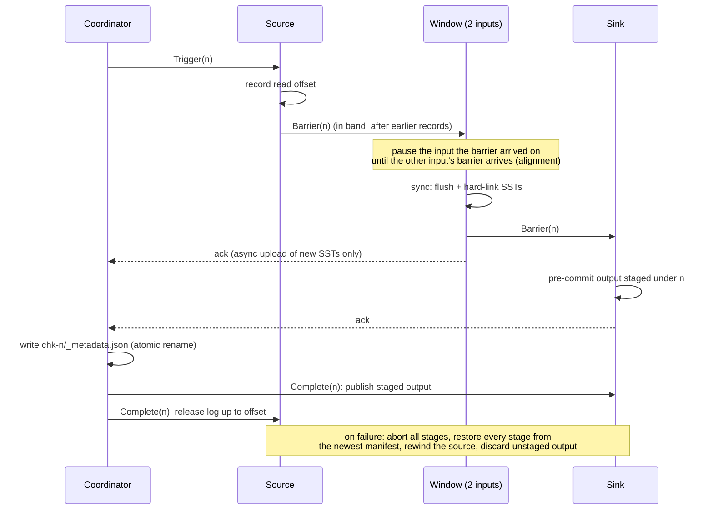
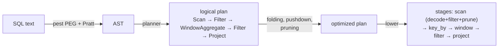

# Sluice

A stateful stream processing engine written from scratch in Rust, with a React
pipeline builder and debugger. It is a single binary that implements the core
of the Google Dataflow / Apache Flink model:

- **Event-time processing**: watermarks; tumbling, sliding and session windows;
  allowed lateness with late-event side outputs; idle sources; watermark
  alignment.
- **Exactly-once fault tolerance**: aligned-barrier checkpoints
  (Chandy-Lamport), incremental RocksDB snapshots, replayable sources,
  two-phase-commit sinks, and rollback recovery.
- **Credit-based backpressure** from the last operator all the way back to the
  gRPC producers.
- **Streaming SQL**: a pest parser, logical plan, rule-based optimizer
  (predicate pushdown, projection pruning, constant folding) and physical plan.
- **Windowed stream-stream joins** (Rust API).
- **Web UI**: a drag-and-drop pipeline builder, a live animated dataflow, a
  time-travel state debugger, a SQL editor with live plan preview, and metrics.

**[Benchmarks](#benchmarks)**: on one Apple M3 laptop, 6.2M events/s for a stateless pipeline, 2.6M/s for keyed windows, 624K/s with RocksDB state and a checkpoint every second, and 353K/s end to end over gRPC through a SQL job. Recovery from a crashed operator takes about 20 ms. The plan's target was 100K+.

## Quickstart

```bash
docker compose up --build          # engine + UI + a generator streaming into 3 example jobs
# or, without Docker:
scripts/run_demo.sh
```

Then open **http://localhost:8080**. Everything runs from the browser:
- **Data sources**: start a synthetic data generator, or paste your own JSON events.
- **Pipelines / SQL editor**: build a dataflow by drag and drop, or write
  streaming SQL with a live plan preview, then deploy it.
- **Jobs**: watch events flow. Hover a stage and click *Kill* to crash it,
  then watch the job restore its latest checkpoint and carry on.
- **Debugger**: scrub through checkpoints and see each window's state as of
  that moment.

Running the pieces by hand:

```bash
(cd frontend && npm install && npm run build)        # the web UI (optional)
cargo run --release                                   # gRPC :50051, REST + UI :8080, checkpoints in ./data
cargo run --release --bin sluice-loadgen -- \
    --submit examples/sql_job.json --rate 2000 --events 0   # stream synthetic purchases
```

**Exactly-once chaos check.** This kills the window operator halfway through the
stream, then compares every window result against what was sent:

```bash
pip install grpcio grpcio-tools
python scripts/generate_events.py --submit-job examples/purchases_job.json \
    --rate 3000 --kill-stage window --kill-at 5000 --verify
# exactly-once check over 750 closed windows: PASS
#   missing=0 duplicates=0 wrong=0 unexpected=0
# job 1: running, restarts=1, checkpoints completed=7 failed=0, restored_from=3
```

<details>
<summary>REST API</summary>

```bash
curl localhost:8080/jobs/1                       # status, restarts, stages, operator metrics
curl localhost:8080/jobs/1/checkpoints           # checkpoint history: sizes, durations, per-stage stats
curl 'localhost:8080/jobs/1/output?limit=20'     # latest committed output
curl -X POST localhost:8080/jobs/1/stages/4/kill # crash a stage on purpose
curl localhost:8080/jobs/1/checkpoints/12/state  # state as of checkpoint 12 (time travel)
curl localhost:8080/streams                      # ingest logs: offsets, retained events
curl -X POST localhost:8080/generators -H 'content-type: application/json' \
     -d '{"stream": "purchases", "rate": 2000}'  # synthetic events at 2000/s (DELETE /generators/:id stops it)
curl -X POST localhost:8080/streams/purchases/events -H 'content-type: application/json' \
     -d '[{"user_id": "user-001", "amount": 42.5}]'  # send your own records
curl -X POST localhost:8080/sql/explain -H 'content-type: application/json' \
     -d '{"query": "SELECT user_id, COUNT(*) AS n FROM purchases WINDOW TUMBLING (SIZE 1 MINUTE) GROUP BY user_id"}'
curl localhost:8080/metrics                      # Prometheus
curl -X DELETE localhost:8080/jobs/1             # cancel
```

Configuration (environment variables):
- `SLUICE_GRPC_ADDR`, `SLUICE_HTTP_ADDR`: listen addresses.
- `SLUICE_DATA_DIR`: where checkpoints are stored.
- `SLUICE_UI_DIR`: the built UI to serve (default `frontend/dist`).
- `RUST_LOG`: log filter.

</details>

## Benchmarks

Measured on an Apple M3 (8 cores) with a release build:

- **Criterion** (`cargo bench`): medians of 10 samples.
- **Load test** (`sluice-loadgen`): the engine and the generator on the
  same machine, talking over localhost gRPC and HTTP.

**Pipeline throughput (in process).** 200K events from source to sink. Every
stage is its own task, connected by credit-based channels:

| Pipeline | Events/s |
|---|---:|
| Stateless map + filter | **6.2 M** |
| Keyed tumbling window (100 keys), memory state | **2.6 M** |
| Sliding window 10 s every 1 s, memory state | **1.8 M** |
| Keyed tumbling window, **RocksDB** state + checkpoint every 1 s | **624 K** |
| SQL: JSON decode + `WHERE` + window + `HAVING` | **916 K** |

**Checkpoint cost per stateful operator.** The *pause* is the synchronous
phase, during which the operator processes nothing. The upload that follows
overlaps with processing.

| Keyed state | Memory: pause | Memory: whole checkpoint | RocksDB: pause | RocksDB: 1 key changed | RocksDB: 1% of keys changed |
|---:|---:|---:|---:|---:|---:|
| 10 K | 0.27 ms | 0.78 ms | 1.1 ms | 6.2 ms | 6.4 ms |
| 100 K | 2.6 ms | 6.9 ms | 1.1 ms | 6.2 ms | 6.9 ms |
| 1 M | 27.7 ms | 78.5 ms | 1.1 ms | 6.3 ms | 18.8 ms |

A RocksDB pause is a memtable flush plus hard links, so it doesn't grow with
state size. Checkpoints are incremental, so each one costs roughly what changed
since the last. The memory backend copies and writes all of its state every
time.

**Restoring an operator's state from a checkpoint:**

| Keyed state | Memory | RocksDB |
|---:|---:|---:|
| 10 K | 1.4 ms | 3.5 ms |
| 100 K | 16.3 ms | 3.5 ms |
| 1 M | 183 ms | 3.4 ms |

RocksDB restores by hard-linking the checkpoint's SST files and opening the
database, so data is read lazily and the cost stays flat.

**End-to-end load tests over the network.** These use
`sluice-loadgen`: four gRPC streams with batches of 1,000.

| Scenario | Result |
|---|---|
| SQL job (`examples/sql_job.json`), 2M events as fast as possible | **634 K events/s** ingested. **353 K events/s** processed end to end: JSON decode, pushed-down filter, window. Checkpoints p50 42 ms, none failed. |
| Operator job with RocksDB checkpoints every 500 ms; 2M events at 200K/s; the **window stage killed after 4 s** | Back to running **21 ms** after the kill; first checkpoint after restart at **22 ms**. All 2M events consumed 10.45 s after the start, so the job kept up with the 200K/s input through the crash. 21 checkpoints, 0 failed. |

The network path is slower than in-process for three reasons: gRPC and protobuf
decoding, a read from the replayable log for every event, and JSON parsing.

To reproduce:

```bash
cargo bench                                   # throughput, checkpoint, recovery
cargo run --release &                         # then, in another shell:
cargo run --release --bin sluice-loadgen -- --submit examples/sql_job.json --events 2000000
cargo run --release --bin sluice-loadgen -- --submit examples/purchases_job.json \
    --events 2000000 --rate 200000 --kill-stage window --kill-after 4
```

## Web UI

Open http://localhost:8080 once the UI is built. To develop it, run
`cd frontend && npm run dev`, which serves it on :5173 and proxies the API and
WebSocket to the engine on :8080.

The console is a light, dense enterprise layout: a top bar with global search
(press `/` to jump to any page or job), a sidebar with a **New** menu, and
quiet charts (one or two series, neutral text) so the data stands out.

| View | What it does |
|---|---|
| **Home** | Ingest rate over time, running jobs, checkpoints and recoveries, the jobs table and the streams. A three-step guide appears until data, a job and a running job exist. |
| **Data sources** | Start and stop generators of synthetic purchases (stream, rate, distinct users, out-of-order spread), see every stream's jobs, ingest rate and replay backlog, and post your own JSON records to any stream. |
| **Pipelines** | A React Flow canvas: drag Source / Filter / Map / Key By / Window / Sink from the palette, connect them top to bottom and configure each one (window kind, sizes, aggregate, allowed lateness, late-event handling). Validation runs as you edit: no cycles, no fan-in or fan-out, every operator on the Source → Sink path, Key By before Window, complete configuration. **Deploy** posts the job definition (shown in the JSON tab) and opens the job. |
| **SQL editor** | Monaco with a streaming-SQL language: highlighting for `WINDOW` / `TUMBLING` / `SLIDING` / `SESSION`, `WINDOW_START`, functions and time units, plus autocomplete with window-clause snippets. While you type, `/sql/explain` drives the plan preview: the optimized or logical plan, the optimizer steps, the physical stages and EXPLAIN text. Errors are underlined at their line and column. **Run query** deploys it as a job. |
| **Jobs** | Every job with its kind, status, stream, checkpoints and restarts. A job page shows ingest, results, checkpoints, recoveries and p99 latency, then tabs for the live **dataflow** (the real stage graph over a WebSocket every 500 ms; long pipelines wrap so every stage stays readable; stages are marked amber when backpressured and red when failed; hover one and click **Kill** to crash it), the latest **output**, per-**operator** counters and the **definition**. **Edit as new** reopens the job in the builder or SQL editor. |
| **Debugger** | A scrubber over the checkpoint history (bar height shows state size). Pick a retained checkpoint to load its state: source read offsets and watermarks, each window operator's watermark, last fired window and late count, and a key browser listing every window's key, bounds and current value, marked new or changed against the previous checkpoint. |
| **Metrics** | Throughput in and out of the job, watermark lag, worst-case backpressure, checkpoint duration, an operator table with trends, checkpoint state size against bytes actually written (how incremental each checkpoint is), and the full checkpoint history. |

The UI's backend endpoints:
- `GET /jobs/:id/live`: a WebSocket that sends the job's status, stage
  topology, operator metrics and recent checkpoints every 500 ms.
- `GET /jobs/:id/checkpoints`: now also lists which checkpoints are still on
  disk.
- `GET /jobs/:id/checkpoints/:n/state`: opens a retained checkpoint read-only,
  restoring RocksDB into a scratch directory, and decodes every stage's state.

## Architecture



**A checkpoint and a recovery:**



**SQL compiler:**



| Crate | Contents |
|---|---|
| `sluice-core` | `Event<T>`, `StreamElement` (record / watermark / barrier / end), the `Operator` trait (`Context`, snapshot and restore), the `KeyedState` interface, the stateless operators, `WatermarkTracker` |
| `sluice-state` | In-memory and RocksDB keyed-state backends, incremental snapshots, checkpoint storage layout |
| `sluice-checkpoint` | `CheckpointCoordinator`, JSON manifests, garbage collection, restart strategy, choosing the checkpoint to restore from |
| `sluice-runtime` | `StreamEnv` / `DataStream` builder, `run_job` supervisor (restarts from checkpoints), stage drivers (barrier injection, N-input alignment, two-phase sinks, side-output splits), credit-based channels, replayable sources with idleness and alignment, window operators (panes, sessions), the window join |
| `sluice-ingest` | tonic `Ingest` service, `EventRouter` with a replayable log per stream, `LogSource` |
| `sluice-sql` | pest grammar, parser → AST, logical planner, rule-based optimizer, physical planner onto `DataStream`, expression evaluation over JSON, EXPLAIN |
| `frontend/` | React 18 + TypeScript UI: React Flow, Monaco, Recharts, Zustand, Tailwind, Vite |
| `sluice-api` (`api/`) | axum REST API, JSON job definitions, `JobManager`, Prometheus exporter |
| `sluice` (`src/main.rs`) | Binary running both servers |
| `sluice-loadgen` (`src/bin/loadgen.rs`) | Load generator and measurement tool: streams synthetic events over gRPC, reports throughput, checkpoint statistics and recovery time |
| `benches/` | Criterion benchmarks: throughput, checkpoint, recovery |

### Programmatic API

```rust
let output = CollectSink::new().exactly_once();
let sink = output.clone();
let config = JobConfig::new("spend")
    .with_checkpointing(CheckpointConfig::new("./data/spend").with_interval(Duration::from_secs(5)))
    .with_restart(RestartStrategy::fixed_delay(3, Duration::from_secs(1)));

// The closure builds the pipeline. It runs again on every restart.
let job = run_job(config, move |env| {
    env.from_iter("purchases", purchases(), WatermarkStrategy::bounded_out_of_orderness(30_000))
        .key_by(|p: &Purchase| p.user_id.clone())
        .window(TumblingWindows::of(Duration::from_secs(300)), Sum(|p: &Purchase| p.amount))
        .sink("output", sink.clone());
})?;
job.wait().await;
```

`StreamEnv::new()` + `execute()` still runs a single pipeline without checkpointing.

```rust
// Sliding windows, allowed lateness, late events to a side output.
let (results, too_late) = clicks
    .key_by(|c: &Click| c.user.clone())
    .windowed(SlidingWindows::of(Duration::from_secs(60), Duration::from_secs(10)))
    .allowed_lateness(Duration::from_secs(30))
    .aggregate_with_late_output(Count);

// Session windows.
let sessions = clicks.key_by(|c: &Click| c.user.clone()).window(SessionWindows::with_gap(Duration::from_secs(30)), Count);

// Windowed inner join.
let joined = clicks
    .join(purchases)
    .on(|c: &Click| c.user.clone(), |p: &Purchase| p.user.clone())
    .window(TumblingWindows::of(Duration::from_secs(60)))
    .apply(|c: &Click, p: &Purchase| (c.page, p.amount));

// Sources: idle after 5s of silence; pause if more than 10s ahead of other "orders" sources.
let strategy = WatermarkStrategy::bounded_out_of_orderness(2_000)
    .with_idleness(Duration::from_secs(5))
    .with_alignment("orders", Duration::from_secs(10));
```

### Job definitions (REST)

```json
{
  "name": "spend-per-user-per-minute",
  "source": { "type": "grpc", "stream": "purchases", "max_out_of_orderness_ms": 2000 },
  "operators": [
    { "type": "filter", "field": "amount", "op": "gt", "value": 0 },
    { "type": "key_by", "field": "user_id" },
    { "type": "window", "window": { "kind": "tumbling", "size_ms": 60000 },
      "aggregate": { "fn": "sum", "field": "amount" } }
  ],
  "sink": { "type": "buffer", "capacity": 5000 },
  "checkpointing": { "interval_ms": 500, "timeout_ms": 60000, "retained": 3, "backend": "rocksdb" },
  "restart": { "max_restarts": 3, "delay_ms": 200 }
}
```

Records are JSON objects. Fields may be dotted paths. Filter ops are
`eq ne gt gte lt lte`, aggregates are `count sum avg min max`, and a window must
come after a `key_by`. If `checkpointing` is left out, the job runs without
fault tolerance and its output is visible immediately.

Window kinds:
- `{"kind": "tumbling", "size_ms": N}`
- `{"kind": "sliding", "size_ms": N, "slide_ms": M}`
- `{"kind": "session", "gap_ms": N}`

Optional window settings:
- `"allowed_lateness_ms"`: late events within this time re-emit the window
  marked `"late_firing": true`.
- `"late_events": "emit"`: events later than that reach the output as
  `{"late_event": <record>}` instead of being dropped.

On the source, `"idle_timeout_ms"` marks the stream idle after that long
without events. [examples/sessions_job.json](examples/sessions_job.json) uses all
of these.

## Streaming SQL

```sql
SELECT user_id, COUNT(*) AS tx_count, SUM(amount) AS total, WINDOW_START AS minute
FROM purchases
WHERE amount > 0
WINDOW TUMBLING (SIZE 5 MINUTES)          -- or SLIDING (SIZE 10 MINUTES, SLIDE 1 MINUTE)
                                          -- or SESSION (GAP 30 SECONDS)
                                          -- optional: ALLOWED LATENESS 30 SECONDS
GROUP BY user_id
HAVING COUNT(*) > 10
```

To run a query, submit it as a job's `query` instead of `operators`; see
[examples/sql_job.json](examples/sql_job.json). Its FROM must name the source
stream. `POST /sql/explain` compiles a query without running it, and errors
include their line and column.

**Supported:**
- Arithmetic `+ - * / %`; comparisons; `AND OR NOT`; `IS [NOT] NULL`.
- Field paths (`order.items.0.price`) and quoted names (`"window"`).
- Aggregates `COUNT(*) COUNT SUM AVG MIN MAX`.
- Scalar functions `LOWER UPPER LENGTH ABS ROUND COALESCE`.
- `WINDOW_START` and `WINDOW_END`.
- SQL NULL semantics: three-valued logic, and a filter keeps a row only if its
  predicate is TRUE.

Aggregating without a WINDOW clause is rejected, because unbounded streaming
aggregation would need retractions.

The compiler has these stages:

1. **Parser** ([grammar.pest](crates/sluice-sql/src/grammar.pest)): a PEG
   grammar with case-insensitive keywords. A Pratt parser resolves operator
   precedence. Error messages name what was expected at the failing line and
   column.
2. **Logical planner**: builds `Scan → Filter (WHERE) → WindowAggregate →
   Filter (HAVING) → Project`. Above the aggregation, GROUP BY expressions and
   aggregate calls are rewritten into references to the aggregated row.
   Identical aggregates are computed once, so `COUNT(*)` in both SELECT and
   HAVING is one accumulator. A column that is neither grouped nor aggregated is
   an error.
3. **Optimizer**, rule-based, with each rule recorded for EXPLAIN:
   - *Constant folding* and boolean simplification (`x AND TRUE` → `x`;
     filters that are always true disappear).
   - *Predicate pushdown*: HAVING conditions that only test grouping columns
     move below the window, so they filter records before those records create
     state. Filters then merge, and move into the scan itself.
   - *Projection pruning*: the scan keeps only the fields the rest of the plan
     reads.
4. **Physical planner**: produces a chain of runtime stages.
   - The scan decodes JSON, filters and prunes in one stage, so rejected
     records never cross a channel.
   - Then `key_by(GROUP BY)`, followed by a window operator whose single
     accumulator holds every aggregate plus the group values.
   - Then filter and project over the aggregated rows.

   These are ordinary operators, so SQL jobs are checkpointed, recovered
   exactly-once and reported in metrics like any other job.

```text
$ curl -X POST localhost:8080/sql/explain -d '{"query": "..."}'
== Optimizations ==
- constant folding: `1 = 1` → `TRUE`
- simplified `amount > 0 AND TRUE` → `amount > 0`
- predicate pushdown: `user_id != 'user-000'` moved from HAVING below the window aggregation
- predicate pushdown: `amount > 0 AND user_id != 'user-000'` evaluated inside the scan of `purchases`
- projection pruning: the scan of `purchases` keeps only [amount, user_id]

== Physical stages ==
1. scan(purchases where amount > 0 AND user_id != 'user-000' fields [amount, user_id])
2. key_by(user_id)
3. window(TUMBLING(SIZE 1 MINUTE): COUNT(*), SUM(amount))
4. filter(COUNT(*) > 10)
5. project(user_id, COUNT(*) AS tx_count, SUM(amount) AS total, WINDOW_START AS minute)
```

## Windows, joins and flow control

**Panes for sliding windows.** Time is cut into panes of
`gcd(size, slide)`. Each event updates one pane's accumulator, and a window's
result merges its panes. A 1-hour window sliding every minute therefore costs
one state update per event instead of 60. Tumbling windows are the special case
where the slide equals the size. Pane keys are `end ++ start ++ key`, so all
panes due at a watermark come back from one range scan. When firing, the
operator skips over stretches with no data instead of stepping through every
window boundary.

**Session windows.** Each event opens `[t, t + gap)` and merges with any of the
key's sessions it overlaps or touches. One out-of-order event can bridge two
sessions. Each session has one timer, ordered by deadline: first its firing
time, then its expiry. So a watermark only touches sessions that are due.

**Lateness.** A window fires when the watermark reaches its end. With allowed
lateness, its state is kept that much longer. A late event within that period
updates the window and re-emits its result (`late_firing: true`). Anything later
is dropped and counted in `late_records`, or routed to a side output
(`aggregate_with_late_output`). Side outputs are a general `split` stage that
sends `Either::Left` and `Either::Right` records to two streams and sends
watermarks and barriers to both.

**Window join.** Elements from both inputs are buffered in keyed state per
(window, key). When the watermark passes the window, every left element is
paired with every right element of the same key. The join is a real two-input
operator: each input converts its records to `Either` as they arrive. It aligns
checkpoint barriers across both inputs, and its watermark is the minimum of the
two.

**Credit-based flow control.** Each channel between stages starts with
`capacity` credits. A sender spends one credit per element and waits when it has
none. The receiver returns credits in batches (a quarter of the capacity), and
always before it would block, so it can never sit on credits a sender is waiting
for. Time spent waiting for credit is the stage's backpressure. It's reported as
`backpressure_ratio` (share of recent time spent waiting), `backpressured_ms`,
and input queue usage, both in the REST metrics and in Prometheus.

**Backpressure reaches producers.** High-volume producers use the
bidirectional `IngestStream` gRPC call, sending batches and receiving an
acknowledgement per batch. The server reads a stream's next batch only after
the current one is in the log, so when jobs fall behind and the log fills up,
HTTP/2 flow control pauses the producer.

**Idleness.** A source with no records for `idle_timeout` sends
`Status(Idle)`. Operators leave idle inputs out of the minimum watermark, so a
quiet side of a join doesn't stall it. When every input is idle, the operator
advances to the highest input watermark, as Flink's status valve does, and
passes the idle status downstream.

**Watermark alignment.** Sources in the same alignment group stop reading while
their watermark is more than `max_drift` ahead of the slowest member's. They
still answer checkpoint triggers while paused. This bounds how much a join or
union has to buffer when one input runs far ahead, for example while replaying
after recovery.

## Fault tolerance

**Checkpoints.** These are aligned barriers, which is the Chandy-Lamport
algorithm specialised to a DAG with FIFO channels.

1. The coordinator sends *Trigger(n)* to every source.
2. Each source records its read offset and watermark state, then injects
   `Barrier(n)` into its output.
3. An operator stops reading an input once that input's barrier arrives, and
   keeps reading the others. When every live input has delivered `Barrier(n)`
   (an input that has ended counts as aligned), the operator snapshots its state
   and forwards the barrier. Records before the barrier are therefore in the
   snapshot, and records after it are not.
4. Each snapshot has two phases:
   - a short synchronous phase while the operator is paused (RocksDB: flush, then
     hard-link the files into a checkpoint);
   - an upload phase on a blocking thread while the operator carries on.
5. When every stage has acknowledged, the coordinator writes
   `chk-n/_metadata.json` atomically. **That file is what makes the checkpoint
   complete.** Then it broadcasts *Complete(n)*.

**Incremental RocksDB snapshots.** SST files never change once written. Each
checkpoint uploads only SST files that no earlier checkpoint uploaded, and lists
the rest by reference. Shared files are named `shared/<stage>/<chk>-<sst>`, so
names stay unique even after a restart, when RocksDB may reuse file numbers.
After each completion, garbage collection keeps the newest `retained`
checkpoints. It deletes unreferenced files only if a checkpoint no newer than the
latest completed one uploaded them, because newer files may belong to a
checkpoint still in progress. Whatever an attempt leaves half-done is removed
when that attempt ends.

**Window state layout.** Window state is keyed by `end ++ start ++ key`
(big-endian), so all windows due at a watermark come back from a single range
scan. The operator's current watermark is checkpointed along with the windows,
so late events are handled the same way after a restore.

**Recovery.** A panic, operator error or killed stage fails the attempt, and
every stage is aborted. The supervisor then rebuilds the pipeline with the same
build closure and restores each stage by its uid (`<index>-<name>`). Sources go
back to their checkpointed offsets and operators reload their state. Restart
counts and delays follow `RestartStrategy`. Checkpoint ids keep increasing
across restarts and across runs, and a new run can resume from a previous run's
checkpoints with `CheckpointConfig::resuming()`.

**Exactly-once end to end** depends on three things:

- **Replayable input.** Each ingest stream is an in-memory log. Every job reads
  from its own offset and commits that offset when a checkpoint completes, and
  events are dropped only after every subscriber has committed past them. When
  the log reaches its retention limit, producers wait, which gives backpressure.
- **Consistent state** from the checkpoint itself.
- **Transactional sinks.** On `pre_commit(n)` at the barrier, a sink stages its
  output. On *Complete(n)* it publishes it. On restore it publishes what the
  restored checkpoint covers and discards anything newer. Output is therefore
  delayed by up to one checkpoint interval.

**Coordinator isolation.** Operators are synchronous user code and can block the
thread they run on. So the coordinator runs on its own thread, the way Flink's
JobManager is separate from the threads running user code. Without this, a
stalled operator could also stall checkpoint triggers and timeouts.

### Known limits (planned for later phases)

- Stream logs live in memory, so a process restart loses events ingested after
  the last checkpoint. Checkpoints themselves are on disk, and the runtime can
  resume from them.
- REST jobs aren't persisted, so they have to be resubmitted after a restart.
- No checkpoint can complete once any source has finished.
- Operators run as tasks on shared Tokio worker threads. An operator that
  blocks its thread (heavy CPU work, synchronous I/O) delays the tasks queued
  behind it on that worker, which also skews the backpressure numbers. The
  checkpoint coordinator already runs on its own thread for this reason; giving
  each stage a dedicated thread, as Flink does, is future work.
- Joins exist in the Rust API only; REST jobs and SQL queries have a single
  source, with no `JOIN`.

## Semantics

- **Watermarks** are separate stream elements. Sources emit
  `max_event_time - max_out_of_orderness - 1` every 1000 records and every
  200 ms. Each operator forwards the minimum watermark across its inputs, and a
  watermark never goes backwards.
- **Windows** are half-open `[start, end)` intervals. A window fires when the
  watermark reaches `end - 1`. Late events are dropped and counted in
  `late_records`.
- **End of stream** acts as a `MAX` watermark: every open window is flushed.
- **Backpressure:** channels between stages are bounded, so a slow stage stalls
  its upstream stages, the stream log and the gRPC callers.

## Development

```bash
cargo test --workspace      # 140 tests: unit, pipeline, windows/joins, SQL, recovery/chaos, gRPC, REST
cargo clippy --workspace --all-targets
cargo bench                 # criterion: throughput, checkpoint, recovery
cd frontend && npm test && npm run build   # topology validation, live layout/rates; type-check and bundle
```

The first build compiles RocksDB, which takes about 2 minutes. Debug builds skip
debug info for dependencies (see `[profile.dev]`), which keeps `target/` under
1 GB instead of about 8 GB.
